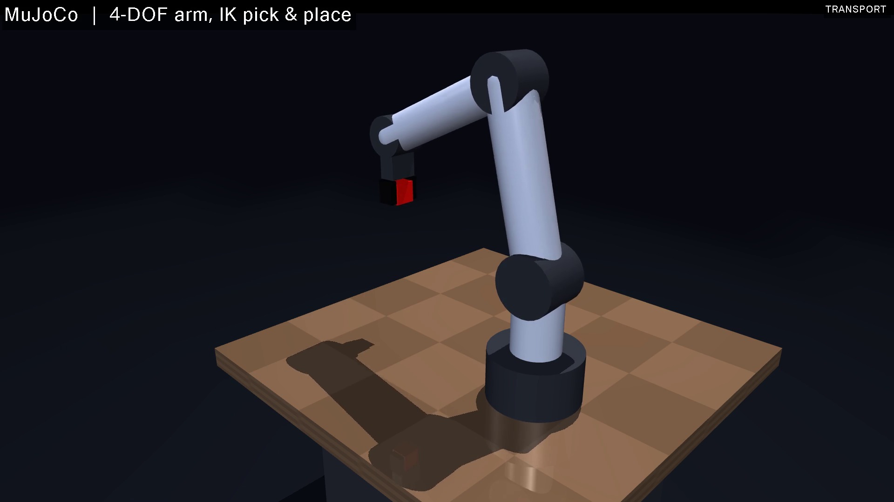

# MuJoCo C++ pick-and-place demo w./ PyTorch

A 4-DOF robotic arm demo, equipped with a two finger gripper, capable of picking and placing down red cubes using a convolutional neural network trained on synthetic data made with damped-least-squares inverse kinematics. There is no friction simulated in this simulation.

Every frame is rendered offscreen and streamed into `ffmpeg`, producing `pick_and_place.mp4`.



| | |
|---|---|
| Video | `pick_and_place.mp4` |
| Scene | `scene.xml` |
| Build | CMake, C++17, MuJoCo 4.0.1 (submodule), GLFW, OpenGL, ffmpeg |

## Build, run, test

Build takes a few minutes since MuJoCo is a submodule.

```bash
git submodule update --init --recursive
cmake -S . -B build -DCMAKE_BUILD_TYPE=Release
cmake --build build -j
ctest --test-dir build --output-on-failure
./build/pick_demo
```

Useful flags (see `--help`):

```bash
./build/pick_demo --out out.mp4 --fps 25
./build/pick_demo --still frame.ppm --time 4.5
./build/pick_demo --still f.ppm --time 4.5 --az -60 --elev -25 --dist 1.2
```

`--still` writes a bottom-up PPM; you may convert with `ffmpeg -i frame.ppm frame.png`.

## Layout

```
src/
  math_util.h        clamp / smoothstep
  model.h            RAII wrappers for mjModel and mjData
  trajectory.{h,cpp} phases + smoothstep sampler (pure data, no MuJoCo)
  robot.{h,cpp}      Arm binding (names -> indices), PD + gravity compensation
  ik.{h,cpp}         damped-least-squares IK for the tool site
  demo.{h,cpp}       the pick-and-place task: model, initial state, control tick
  renderer.{h,cpp}   hidden GLFW window, mjvScene/mjrContext, camera, PPM
  video_writer.{h,cpp} ffmpeg pipe (raw RGB24 -> H.264)
  options.{h,cpp}    CLI parsing
  app.{h,cpp}        still / video run loops
  main.cpp           argument handling and error boundary
tests/
  core_tests.cpp     trajectory interpolation + IK convergence/orientation
```

**CMake builds two libraries so the simulation can be reused without the window
or encoder**

- **`pickdemo_core`**: `trajectory`, `robot`, `ik`, `demo`. Depends only on
  MuJoCo. This is the part to link from a controller, a planner or a test.
- **`pickdemo_io`**: `renderer`, `video_writer`, `options`, `app`. Adds GLFW,
  OpenGL and ffmpeg. `pick_demo` is a thin `main` over `pickdemo_io`.

## Other Files

```
scene.xml           MuJoCo model (arm, gripper, table, cube, lights)
src/, tests/        sources (see layout above)
third_party/mujoco/ MuJoCo 4.0.1 source submodule (built by CMake)
pick_and_place.mp4  recorded result
demo_frame.png      poster frame
```
